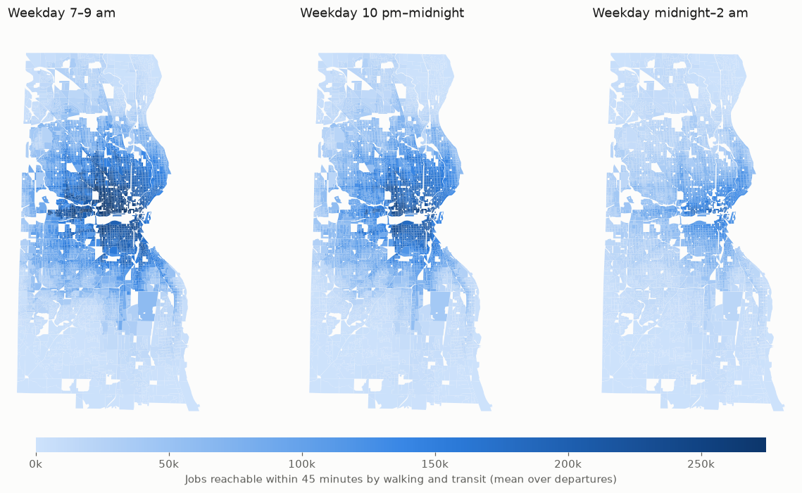

# Timeshed

[](https://github.com/FrankBStack/Timeshed/actions/workflows/ci.yml)

A door-to-door transit travel time engine, and what it says about Milwaukee and
Cincinnati after dark.

Drop a pin anywhere in Milwaukee County and the area you can reach within N minutes by
walking plus public transit redraws as you drag. The routing is an own implementation of
[RAPTOR](https://www.microsoft.com/en-us/research/wp-content/uploads/2012/01/raptor_alenex.pdf)
over the agency's published GTFS schedule, joined to a walking graph built from
OpenStreetMap, so a query covers walking to the stop, riding, transferring and walking
to the door. It routes on the timetable itself rather than on average frequencies,
so leaving at 8 am and leaving at 11 pm give different shapes.


**Try it:** <https://timeshed.frankbs.dev/>. Drag the pin, scrub the time of day,
and click anywhere to see how you'd get there. The engine is compiled to WebAssembly
and runs in your browser; the page downloads a city's schedule and walking network
once (7 MB) and answers each drag in about 160 ms with no server involved. The city
menu switches to Cincinnati; the Findings tab holds the analysis below, block by block,
for either city.

Everything is built from two free sources per city: the agency's GTFS feed
([MCTS](https://kamino.mcts.org/gtfs/google_transit.zip), [Cincinnati Metro](https://www.go-metro.com/uploads/GTFS/google_transit_info.zip))
and the state's [Geofabrik extract](https://download.geofabrik.de/north-america/us/). Adding
a city is an entry in `cities.json`.

## The finding: Milwaukee's transit holds up until midnight, then falls off a cliff

The usual accessibility number, jobs reachable by transit in the morning peak, already
exists for every large US metro (the University of Minnesota's Access Across America
series). So this asks a question that series does not: **how much of that access
survives late at night?** For every inhabited 2020 census block in Milwaukee County
(10,685 blocks, 938,501 residents) the engine computed the number of jobs reachable
within 45 minutes door to door, leaving every 10 minutes across a two-hour window and
averaging. Jobs are 2023 LODES workplace counts by block (547,164 jobs in the study
area, 496,457 of them in the county).

Jobs reachable within 45 minutes, for the median resident and on average, and the
share of residents who can reach at least 100,000 jobs or fewer than 5,000. All
figures are population weighted.

| Leaving | Median | Mean | ≥ 100k | < 5k |
|---|---:|---:|---:|---:|
| Weekday 7–9 am | **104,226** | 112,169 | 51% | 5.0% |
| Weekday noon–2 pm | 87,064 | 96,218 | 44% | 5.1% |
| Weekday 10 pm–midnight | **78,129** | 88,938 | 41% | 6.5% |
| Weekday midnight–2 am | **33,932** | 48,648 | 15% | 7.0% |
| Sunday 7–9 am | 92,406 | 101,587 | 48% | 5.2% |

- Between 10 pm and midnight the median block still has **79%** of its morning job
  access. Only 4% of residents lose more than half. Sunday morning is nearly a weekday.
- After midnight the number drops to **41%** of the morning value. Two thirds of
  residents lose more than half their access, and one in ten loses three quarters.
- That matches the schedule: a dozen or so routes still have departures after
  midnight, and after 1 am it is mostly the Green Line (Bayshore to the airport through
  downtown), the Purple Line (27th Street), the Blue Line and route 30. What survives is
  downtown, the east side and the Green Line corridor; the south and northwest edges of
  the county fall back to walking distance.



### The same question in Cincinnati

Cincinnati Metro is a bus-only system of similar size that made the opposite choice:
under its 2020 levy it put several routes on 24-hour service, and the feed shows up to
30 after-midnight departures on a single route, with the last at 4:45 am. The same
five windows for every inhabited block in Hamilton County (7,355 blocks, 830,399
residents; 534,847 jobs in the county):

| 45-minute budget | Milwaukee | Cincinnati |
|---|---:|---:|
| Median resident's reach, weekday 7–9 am | 104,226 jobs | 26,156 jobs |
| Residents reaching 100,000+ in the morning | 51% | 20% |
| Residents under 5,000 in the morning | 5% | 19% |
| Share of morning access kept 10 pm–midnight | 79% | 82% |
| Share kept midnight–2 am | 41% | 60% |
| Residents losing more than half after midnight | 66% | 38% |

So the all-night routes do what they are for: Cincinnati keeps three fifths of its
access through the night where Milwaukee keeps two fifths, and far fewer residents fall
off a cliff. But it is three fifths of a much smaller number. The median Cincinnati
resident can reach a quarter of the jobs the median Milwaukee resident can at 8 am,
on hillier ground with slower, longer routes radiating from one downtown hub, and one
in five Cincinnati residents starts the day under 5,000 jobs. Night service is a
question of what you keep; daytime frequency is a question of what you have.

Cincinnati's study area stops at the Ohio River: Northern Kentucky's TANK is a
separate system and is not included, and jobs across the river are not counted.

### Who loses after midnight

The obvious follow-up is whether the people who work nights are the ones left
without a bus. LODES breaks jobs out by wage band and sector, and workers by wage
band at their home block, so the same batch runs answer it. Two things I expected
to find, and did not:

- **Low-wage workers are not disproportionately stranded.** Weighted by where
  low-wage workers (under $1,250 a month) live, the median one can reach 22,556
  low-wage jobs at 8 am and 7,654 after midnight, keeping 40% of morning access.
  Weighted by everyone else, the numbers are 20,886, 7,078 and 40%. Low-wage
  workers live closer to the frequent network, so they start slightly ahead and
  fall by the same share.
- **The night-shift sectors fall like everything else.** Health care (101,590
  jobs in the study area) and food service (41,444) keep 39% of the morning reach
  after midnight; all jobs keep 41%. The after-midnight network is a few radial
  lines through the core, and it does not favour hospitals.


What the uniformity hides is how little is left: after midnight, a third of low-wage
workers can reach fewer than 5,000 low-wage jobs within 45 minutes. The problem is
not that the night network cuts some neighbourhoods harder than others. It is that
after 1 am it cuts everyone to four lines.

### Caveats

- Schedules, not real time. A 45-minute budget on paper is a 45-minute budget on a day
  when every bus is on time. The feed is MCTS's September 2026 schedule; jobs are from
  2023.
- Walking is 1.3 m/s on the OSM pedestrian network, with footpaths between stops up to
  1 km. Stops, pins and blocks attach to the nearest point on the nearest walkable edge.
- No boarding slack by default: a bus that leaves the second you reach the stop counts
  as caught. r5 and OpenTripPlanner assume a minute. Rerunning every window with
  `--board-slack 60` lowers the levels by 10 to 16% (the morning median falls from
  104,226 to 87,900) and moves the between-window ratios by one or two points (79% to
  81%, 41% to 43%). Read the levels as optimistic by about that much; the shape holds.
- Only trips on the queried service day count; after-midnight departures use that
  day's late trips, which is all that runs before 4 am. The Hop streetcar and
  neighbouring counties' systems are separate feeds and not included.
- "Low-wage" is LODES earnings band CE01, which also includes part-time and student
  workers. In the ratio views of the map, blocks at the county's edges show ratios near
  1 only because they had little transit access in the morning to begin with.

## How it works

```
GTFS zip ─ gtfs.rs ─ timetable.rs ─┐
                                   ├─ engine.rs ─ bundle.bin
OSM .pbf ─ osm.rs ─ walk.rs ───────┘                │
                                                    ▼
query:  walk from pin ─► raptor.rs ─► walk from reached stops
                                            │
        isochrone.rs  labels → 100 m grid → contours → bands
        access.rs     labels → destination blocks → sums
        wasm.rs       the same, via wasm-bindgen, in the browser
        server.rs     the same, via axum, for `timeshed serve`

reference.rs: brute force; checks raptor.rs on random + real feeds
```

- **Timetable.** GTFS routes are regrouped into RAPTOR routes: trips that share an
  exact stop sequence and board/alight pattern and never overtake each other (322 of
  them for MCTS's 52 routes). Frequency-based trips are expanded. Service is resolved
  per date from `calendar.txt` and `calendar_dates.txt`.
- **Walking graph.** Two passes over the state extract: node coordinates inside the
  bounding box (the stops' box plus 2.5 km), then ways a pedestrian can use. Ways
  leaving the box are cut at its edge, only the largest connected component is kept,
  and runs of shape nodes are merged into single edges of at most 150 m. Milwaukee
  County is 259k nodes and 818k directed edges.
- **RAPTOR.** Standard round-based scan with per-round labels, local pruning against the
  best-known arrival and a time budget, binary search for the first catchable trip
  (valid because routes are non-overtaking), and footpaths relaxed to a fixed point
  after each round, since ours are a bounded walking search rather than a transitive
  closure.
- **Door to door.** The pin attaches to the nearest point on the nearest edge (both
  ends become sources); a bounded Dijkstra seeds every stop in walking reach; RAPTOR
  runs; a multi-source Dijkstra from every reached stop labels the walking nodes.
  Isochrones paint node labels and the edges between them onto a 100 m grid and cut it
  into 5-minute bands. Clicking a point reconstructs the journey from the round-indexed
  RAPTOR labels and the walking predecessors.
- **Batch.** Destinations are snapped once; each origin's query is read at each
  destination's node. Rayon runs origins in parallel with one query workspace per
  thread.
- **Browser.** The routing core has no OS dependencies and compiles for `wasm32`; the
  readers, CLI, server and rayon sit behind the default `native` feature. The page
  talks either to the server's `/api` or to a web worker running the wasm, and has two
  modes, Explore and Findings, each loading its data when first opened. The bundle is
  f32 coordinates and the contracted graph: 21 MB, 7 MB gzipped, inflated by the browser.

### How I know the router is right

RAPTOR is easy to get subtly wrong, so there is a second router that is easy to
get right: a plain time-dependent Dijkstra over stops on the raw feed, with no
route grouping, no rounds and no pruning (`src/reference.rs`).

- `cargo test` builds 200 random feeds with loops, short-turns, frequency-based
  trips, no-pickup and no-drop-off stops, two service patterns and random
  footpaths, and compares every stop label from RAPTOR with brute force over
  10,000 queries. It caught one real bug before the first comparison with r5.
- `timeshed verify` does the same on a real bundle: on the Milwaukee feed, 5,000
  random queries (one to three origin stops, any date, any hour, 90-minute budget)
  compared 17 million reached stop labels with zero disagreements, and the default
  cap of six transit legs lost none of them.

Those checks prove RAPTOR agrees with a simpler router on the same data. To check
the whole door-to-door pipeline, including the walking graph, snapping and
transfers, `analysis/crosscheck_r5.py` runs the same 150 origins and 150
destinations through [r5](https://github.com/conveyal/r5) (Conveyal's router, via
r5py) on the same feed and extract, at 8:00 on the same weekday with a two-hour
budget. The two share no code; the only rule copied is R5's 60-second boarding slack.


| Against r5 | |
|---|---:|
| Pairs reachable by both within two hours | 19,474 of 22,500 |
| Reachable by only one router (nearly all over 80 minutes, at the edge of the budget) | 854 Timeshed, 2 r5 |
| Median difference (Timeshed minus r5; r5 reports whole minutes) | +0.4 min |
| Within 1 / 2 / 5 minutes | 86% / 91% / 95% |
| 95th percentile of the absolute difference | 5.5 min |

Most of what remained after the slack fix was how points attach to the street
network: snapping to the nearest node could cost a detour of a block, and attaching
to the nearest point on the nearest edge instead took the share within a minute
from 68% to 86%.

### Numbers on a 12-core laptop

| Step | Time |
|---|---:|
| Read the feed (1.0M stop_times) | 0.6 s |
| Full bundle build: walking graph from the 294 MB state extract, contraction, 106k footpaths | ~3 s |
| Door-to-door query, 45-minute budget | ~13 ms |
| 60-minute isochrone: 21 ms routing + 41 ms of bands, as GeoJSON | ~60 ms |
| Batch: 10,690 origins × 12 departures | ~110 s |
| Same 60-minute isochrone, WebAssembly in Brave, including drawing | ~160 ms |

## Running it

```sh
# build the bundle (any GTFS feed plus an OSM extract that covers it)
cargo run --release -- build --gtfs data/raw/gtfs/mcts.zip \
    --osm data/raw/osm/wisconsin-latest.osm.pbf \
    --name "Milwaukee County Transit" -o data/bundles/milwaukee.bin

# one query, with the journey to a point
cargo run --release -- query --bundle data/bundles/milwaukee.bin \
    --lat 43.0389 --lon -87.9100 --date 2026-10-08 --time 08:00 \
    --max 45 --to-lat 43.1226 --to-lon -87.9152

# the live map on http://127.0.0.1:8080
cargo run --release -- serve --bundle data/bundles/milwaukee.bin

# the published site as static files (needs wasm-pack), then open :8090
scripts/build-web.sh milwaukee=data/bundles/milwaukee.bin
(cd docs && python3 -m http.server 8090)
```

Reproducing the analysis, from the census downloads to the figures, is in
[`analysis/README.md`](analysis/README.md). The `data/` directory is not committed.

The published site is not committed either: `.github/workflows/site.yml` downloads
each city's current schedule, rebuilds the bundles and the wasm, renders the pages,
smoke-tests them in a browser and deploys them to Cloudflare Pages on every relevant
push and every Monday, and refuses to deploy a feed that does not cover the coming
week. Cities are listed in `cities.json`; a city gets a Findings tab when its analysis
has been run.

## Layout

```
src/gtfs.rs       GTFS reader
src/timetable.rs  RAPTOR route grouping
src/osm.rs        walking graph from a PBF extract
src/walk.rs       r-tree, edge snapping, bounded Dijkstra
src/raptor.rs     the algorithm, with journey reconstruction
src/reference.rs  brute-force router the tests check RAPTOR against
src/engine.rs     bundle, door-to-door query, itineraries
src/isochrone.rs  grid + marching squares
src/access.rs     batch accessibility and pairwise matrices
src/server.rs     axum API           src/wasm.rs   browser bindings
web/              the map (MapLibre) and its worker
scripts/          build-web.sh, render-pages.py, smoke.mjs
analysis/         census + LODES prep, summary, figures, r5 cross-check
cities.json       the cities: feed, extract, analysis county
docs/             inputs to the site: block data, figures, cache headers
```

## License

MIT. Transit data is the agency's, map data is © OpenStreetMap contributors,
and census data is public domain.
